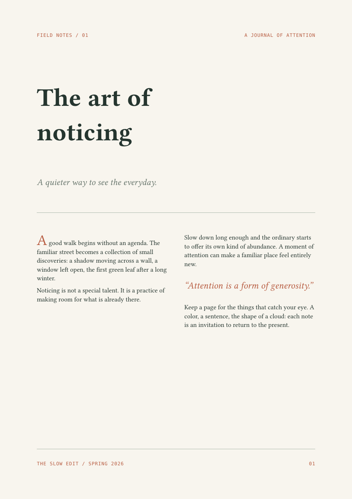
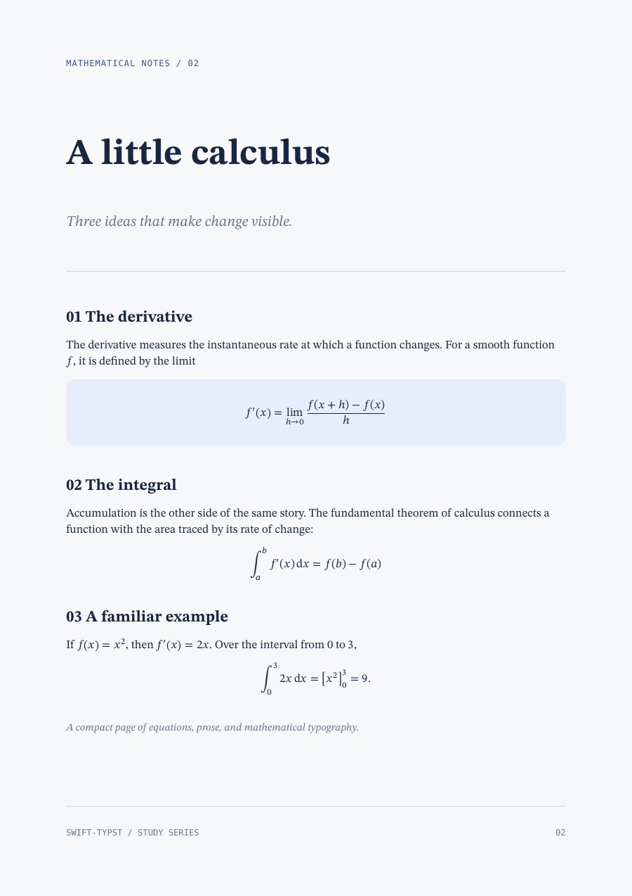
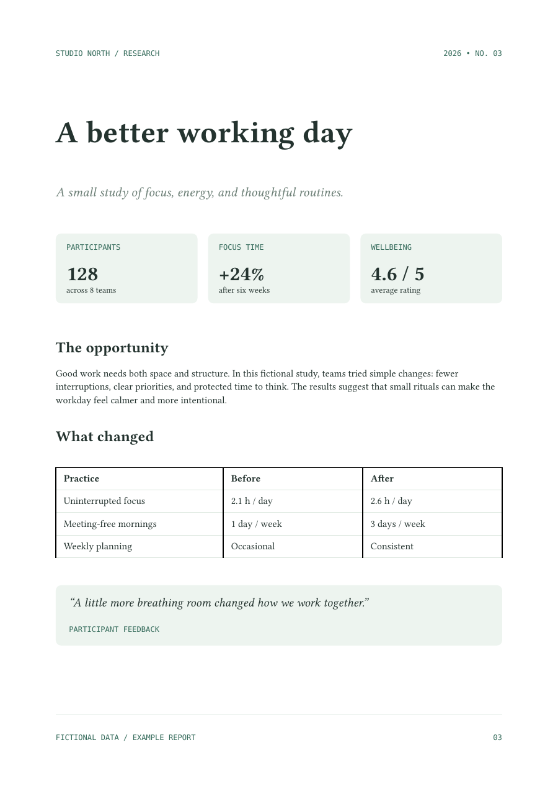
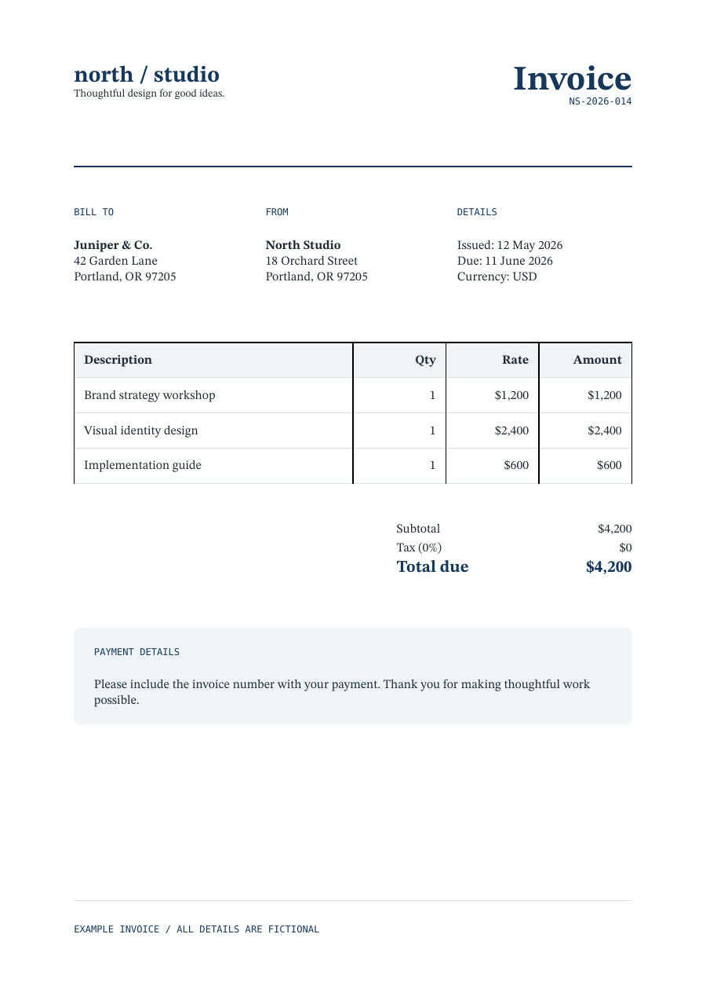
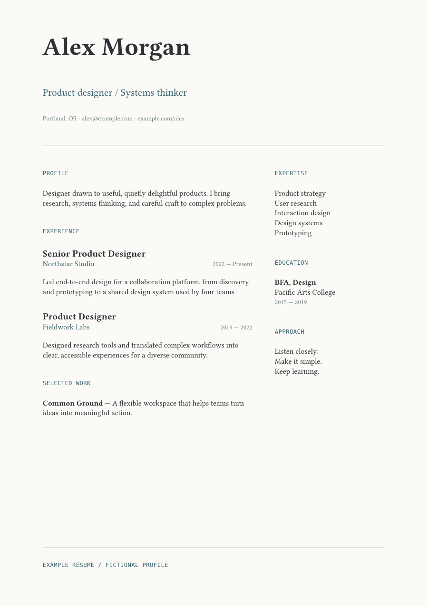
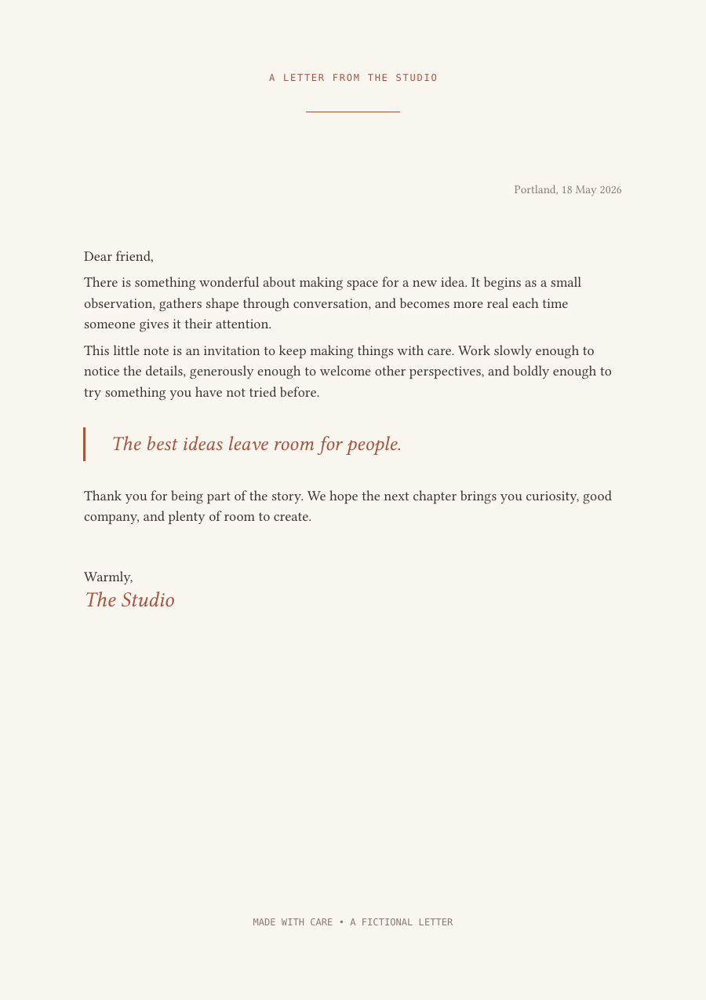

# Swift-Typst

[](https://github.com/ThorFuchs/Swift-Typst/actions/workflows/ci.yml)
[](https://thorfuchs.github.io/Swift-Typst/)
[](https://swift.org/)
[](https://typst.app/)
[](LICENSE)

[Read the Swift API documentation →](https://thorfuchs.github.io/Swift-Typst/)

The documentation website follows `main`; released versions can differ.

Swift 6.4.2 interface to the embedded Typst 0.15.1 compiler. Version 1 focuses
on compiling in-memory projects to PDF; editor/IDE APIs and other exports are
outside its current scope. Calls are synchronous and do not invoke a subprocess.

> **Platform scope:** version 1.0.0 supports the platform variants and WASI host
> described below. Browser hosting, remaining license uncertainty and validation
> limits are documented in
> [Documentation/PRODUCTION-STATUS.md](Documentation/PRODUCTION-STATUS.md).

## Example gallery

Six one-page documents, rendered to PDF with `TypstCompiler` and the bundled
fonts. Select a preview to explore its Typst source.

| Editorial | Mathematics |
| :---: | :---: |
| [](Examples/Documents/01-editorial.typ) | [](Examples/Documents/02-mathematics.typ) |
| **Research report** | **Invoice** |
| [](Examples/Documents/03-report.typ) | [](Examples/Documents/04-invoice.typ) |
| **Résumé** | **Letter** |
| [](Examples/Documents/05-resume.typ) | [](Examples/Documents/06-letter.typ) |

See the [gallery guide](Examples/README.md) to render the PDFs and regenerate
the previews. Names, contact details and data in the examples are fictional.

## Installation

Add the published package to a SwiftPM manifest:

```swift
.package(url: "https://github.com/ThorFuchs/Swift-Typst.git", from: "1.0.0")
```

Use the `SwiftTypst` product from the `Swift-Typst` package. The release
manifest selects a checksum-pinned prebuilt bridge; a supported consumer does
not need Rust or manual linker flags.

## Compile a document

```swift
import Foundation
import SwiftTypst

let result = try TypstCompiler().compilePDF("= Hello, Typst!")
try result.pdf.write(to: URL(fileURLWithPath: "hello.pdf"))
print("\(result.pageCount) pages; \(result.warnings.count) warnings")
```

Projects may include files, assets and explicit packages without touching the
filesystem or network:

```swift
let project = TypstProject(main: "main.typ", files: [
    "main.typ": .text("#import \"chapter.typ\": title\n= #title"),
    "chapter.typ": .text("#let title = [Hello from Swift]"),
])
let options = TypstCompileOptions(inputs: ["customer": "Rhoe"])
let result = try TypstCompiler().compilePDF(project, options: options)
```

Additional fonts, in-memory Typst packages, fixed/unavailable clocks, PDF
standards, page ranges and byte limits are available through the public value
types. `TypstError` contains a stable wrapper error code and structured Typst
diagnostics. Source ranges are zero-based, half-open UTF-8 byte offsets;
package paths include their package identity. Warnings accompany successful
PDFs. Page selection in Typst 0.15.1 requires `tagged: false`.

The compiler runs synchronously. In interactive apps schedule it away from the
main actor; independent calls can be made concurrently. The byte limits cover
the sum of supplied file/font bytes and the returned PDF respectively. The
output limit is checked *after* export, and neither limit bounds peak memory or
execution time. Cancellation, hard resource isolation, network fetching, system
font discovery and a general-purpose sandbox are not provided. Supply all
needed files, packages and fonts explicitly. The pinned bundled set contains
Libertinus Serif, STIX Two text and math, and DejaVu Sans Mono; its license
notices are included in the generated artifact. STIX Two Math is the default
for equations when bundled fonts are enabled. A document's explicit math font
rule takes precedence. New Computer Modern is not bundled: selecting it may
produce a missing-font warning unless the caller supplies the required faces via
`TypstProject.fonts`. Font selection affects layout, Unicode coverage and PDF
text extraction; see [the font investigation](Documentation/FONT-INVESTIGATION.md).
The krilla/resvg provenance and historical font distribution questions remain
documented in [Notices/README.md](Notices/README.md). The release owner's
scoped decision on the remaining krilla risk is recorded in
[RELEASE-RISK-DECISION.md](Documentation/RELEASE-RISK-DECISION.md).

## Local build

Install Swift 6.4.2, Rust 1.94.1 and the desired Rust target. For example, on
Apple Silicon macOS:

```sh
rustup target add aarch64-apple-darwin
python3 Scripts/configure-binary-target.py --local
sh Scripts/build-artifact.sh aarch64-apple-darwin
swift test
swift run --package-path Tests/Consumer Consumer
```

This changes the checked-out manifest to use an ignored local artifact. Restore
`Package.swift` from Git to return to the published binary target. See
[Artifacts/README.md](Artifacts/README.md) for target mappings, provenance,
ZIP packaging and release prerequisites.

## Verification and next steps

Build the DocC reference locally on macOS with `sh Scripts/build-docc.sh`.
The documentation workflow builds the same static site and publishes it to
GitHub Pages when relevant files on `main` change.

The implementation's local evidence, including precise scope and remaining
release gates, is in [Documentation/PRODUCTION-STATUS.md](Documentation/PRODUCTION-STATUS.md).
The historical design and decisions are recorded in
[Documentation/IMPLEMENTATION-ROADMAP.md](Documentation/IMPLEMENTATION-ROADMAP.md)
and [Documentation/API-DESIGN.md](Documentation/API-DESIGN.md). The font and
license research is retained under [Spike/LicenseRelease](Spike/LicenseRelease/README.md).

The Swift-Typst source is licensed under [Apache-2.0](LICENSE). Bundled and
transitive components have their own licenses and notices.
